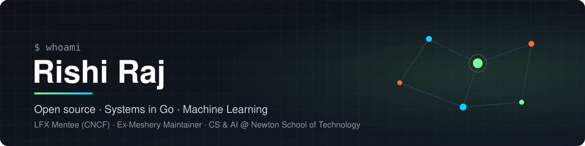

  

  
  
  
  

---

## 👋 About me

I'm a third-year CS & AI student at **Newton School of Technology** who likes building things from the ground up and understanding how they actually work underneath.

I spent a good chunk of my time in open source as a **maintainer across Meshery** (a CNCF project), and did my **LFX mentorship** there adding OCI registry support for Meshery models. These days I'm writing systems code in Go, like a vector database built from scratch, and going deep on machine learning.

- 🔭 Building **[quiver](https://github.com/rishiraj38/quiver)**, a vector database in pure Go
- 🧠 Working through a long-term ML roadmap: maths, classical ML, deep learning, research papers
- 🤝 Open to internships in backend, infra and ML engineering

---

## 💼 Experience

<table>
<tr>
<td width="80" align="center" valign="top">
  
</td>
<td valign="top">

**LFX Mentee · CNCF / Meshery** &nbsp;·&nbsp; *2026 Term 2* 
Models Support for OCI Registries · Linux Foundation Mentorship

Added support for storing and distributing Meshery models through OCI registries, so models can be pushed and pulled the same way as container images.

- Built OCI/ORAS-based model registry support in Meshery
- Worked hands-on with the OCI spec: blobs, manifests, digests, media types and multi-platform images

</td>
</tr>
<tr>
<td width="80" align="center" valign="top">
  
</td>
<td valign="top">

**Maintainer · Meshery (CNCF / Layer5)** &nbsp;·&nbsp; *Graduated 2026* 
Meshery UI · Meshery Cloud · Kanvas · Sistent · Schemas

- **300+** PRs reviewed, **100+** merged as maintainer, **100+** of my own PRs merged
- Led the permission-shield migration across Meshery UI, Meshery Cloud and Kanvas, moving permission checks into Sistent so consumer repos only pass a permission key and action
- Drove the "evaluate design" permission key end to end, from `meshery/schemas` to `meshery/meshery`

</td>
</tr>
</table>

---

## 🚀 Featured Projects

<table>
<tr>
<td width="50%" valign="top">

### [⚡ quiver](https://github.com/rishiraj38/quiver)
Vector database written from scratch in Go with **zero third-party dependencies**. HNSW index, write-ahead log with group commit, snapshots and crash recovery.

- **0.99 recall@10** at ~3.8k QPS per core on SIFT1M, between FAISS and hnswlib
- Hand-written **ARM64 NEON** kernels, 2.5× faster than compiled Go
- Group commit took durable writes from 420 to **14,900/sec**

  &nbsp;[**Live demo →**](https://quiver-i5qu.onrender.com)

</td>
<td width="50%" valign="top">

### [📰 Helix](https://github.com/rishiraj38/news-aggregator)
Autonomous news pipeline that runs unattended every day. It pulls ~400 articles from 13 sources, summarises them with an LLM, ranks them per subscriber and sends a personalised email.

- Auto-posts top stories as an Instagram carousel
- Runs on a GitHub Actions cron, no server to babysit
- Next.js dashboard with Clerk auth and Prisma

   &nbsp;[**Live →**](https://helix-seven-eta.vercel.app)

</td>
</tr>
<tr>
<td width="50%" valign="top">

### [🚑 OpenEnv RL Environments](https://huggingface.co/spaces/rishi38/SmartCity-Emergency-Dispatch)
**Finalist, Meta × Hugging Face OpenEnv Hackathon.** Built two reinforcement learning environments: Smart City Emergency Dispatch and Email Triage.

- Five-component reward and Dijkstra-based dispatch routing
- SFT + GRPO training pipeline targeting Qwen2.5-7B-Instruct

  

</td>
<td width="50%" valign="top">

### [🎤 AeroPrep](https://github.com/rishiraj38/AeroPrep)
AI mock-interview platform that runs realistic interview sessions and gives feedback on your answers.

- Full-stack app with Next.js frontend and Express API
- Prisma on NeonDB serverless Postgres

   &nbsp;[**Live →**](https://ai-interview-coach-eight-mu.vercel.app)

</td>
</tr>
</table>

---

## 🛠️ Tech Stack

**Languages** 
   

**Cloud Native & DevOps** 
     

**Backend & Data** 
     

**AI / ML** 
     

**Frontend** 
  

---

## 🏆 Achievements

<table>
<tr>
<td width="200" align="center">
  
</td>
<td valign="middle">

- 🎓 **LFX Mentee**, CNCF – Meshery: Models Support for OCI Registries (2026 Term 2)
- 🛡️ **Former Meshery Maintainer**: 300+ PRs reviewed across the project
- 🏅 **Certified Meshery Contributor**, Layer5
- 🥈 **Finalist**, Meta × Hugging Face OpenEnv Hackathon
- 💻 **LeetCode**: 1551 contest rating, 360+ problems solved

</td>
</tr>
</table>

---

## 📊 GitHub Activity

  
  &nbsp;
  

  

  

---

  <b>Let's build something.</b> Reach out on <a href="https://www.linkedin.com/in/rishi-raj-3488432ab/">LinkedIn</a> or check out my <a href="https://rishiraj38.github.io">portfolio</a>.

  

